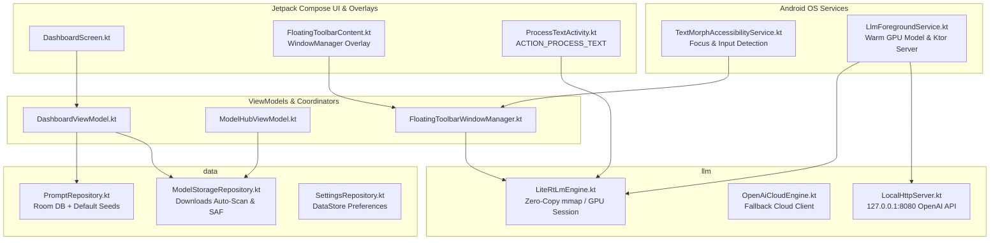

# AI Agent & Contributor Engineering Guidelines — TextMorph

> **Target Audience**: AI Coding Agents (LLMs) and human contributors modifying or extending the **TextMorph** codebase.
> **Primary Rule 1 (Git Synchronization - Start & Finish)**:
> - **Before starting**: ALWAYS run `git pull origin main` BEFORE starting any research, planning, or code implementation to ensure your branch is never working behind `main`.
> - **When done**: ALWAYS run `git push origin main` AFTER completing implementation, verifying test passes, and updating versions so that changes are never left unpushed on local branches.
> **Primary Rule 2 (Near Logging & Robust Error Capture - No Silent Bugs)**: ALWAYS write immediate ("near") logging and robust error capture at every failure-prone site, boundary, repository method, and coroutine. NEVER swallow exceptions silently (`catch (e: Exception) {}` is strictly forbidden). Always log rich contextual metadata and stack traces using `AppLogger` (`com.textmorph.app.util.AppLogger`) or `android.util.Log` so that every failure is immediately detectable, traceable, and visible in Dev Logs.
> **Primary Rule 3 (Architectural Contracts)**: Read and strictly adhere to these architectural contracts before proposing or implementing changes.

---

## 1. Architectural Overview & Philosophy

TextMorph is built with **Modern Android Architecture (MVVM)**, **Jetpack Compose (Material 3)**, **LiteRT-LM (On-Device Gemma 4 Multimodal Inference)**, **Android Accessibility Service**, and an embedded **Ktor Localhost Server**.



### Core Principles
1. **Single Source of Truth (SSOT)**: State is owned by a single dedicated manager. Never duplicate state across multiple ViewModels or Services.
2. **Unidirectional Data Flow (UDF)**: ViewModels emit immutable `StateFlow<UiState>` to Composables. User actions flow up as intents/function calls.
3. **Zero Context Leaks**: Never retain Android `Context`, `Activity`, `View`, or `AccessibilityNodeInfo` references inside ViewModels, singletons, or coroutines outliving the UI lifecycle. Always recycle `AccessibilityNodeInfo` instances.
4. **Thread Isolation**: All file I/O, LiteRT-LM model loading, database operations, and network requests MUST run on `Dispatchers.IO`. The main thread is reserved exclusively for UI rendering and window dispatching.
5. **Zero-Copy Memory-Mapping (mmap)**: Multi-gigabyte `.litertlm` models from the user's `Downloads/` directory must be mapped directly via file path or `ParcelFileDescriptor` with `MANAGE_EXTERNAL_STORAGE` or SAF. Never copy multi-gigabyte models into internal private storage unless explicitly requested by the user.
6. **Strict No-Thinking Policy**: All on-device inference generation configs must enforce `thinking = false` so that responses are immediately insertable into editable input fields without containing raw `<think>` traces.

---

## 2. Subsystem Enforcement Rules

### A. On-Device LLM & Inference Engine (`com.textmorph.app.llm`)
- **Single Active Model Session**: Guard the LiteRT-LM session with a Kotlin `Mutex`. Multiple concurrent prompts from the floating toolbar and the local Ktor server must queue sequentially to avoid GPU out-of-memory crashes.
- **Hardware Acceleration**: Attempt initialization on `Backend.GPU` first. Gracefully catch VRAM exhaustion and fall back to CPU with multi-threaded XNNPACK.
- **Strict Stream Handling**: Stream outputs token-by-token using `Flow<String>` to support real-time typing animation in UI overlays.

### B. Accessibility & Floating Toolbar (`com.textmorph.app.service.overlay`)
- **Overlay Window Management**: Floating Compose views added via `WindowManager` must specify:
  - `WindowManager.LayoutParams.TYPE_ACCESSIBILITY_OVERLAY`
  - `FLAG_NOT_FOCUSABLE | FLAG_NOT_TOUCH_MODAL | FLAG_LAYOUT_IN_SCREEN`
  - This ensures soft keyboards never dismiss and target input boxes retain focus.
- **Compose in Service Lifecycle**: Always attach a valid `LifecycleOwner`, `ViewModelStoreOwner`, and `SavedStateRegistryOwner` to the `ComposeView` before adding it to `WindowManager`.
- **Node Text Replacement**: Verify `node.isEditable` and ignore placeholder hints via `node.isShowingHintText`. Use `ACTION_SET_TEXT` with bundle arguments, falling back to clipboard + `ACTION_PASTE` only if direct replacement is unsupported.

### C. Data Persistence & Room (`com.textmorph.app.data`)
- **Thread-Safe Repository State**: All read/write operations modifying database state must run on `Dispatchers.IO` and be synchronized using Kotlin `Mutex`.
- **Atomic Operations**: Critical configuration and preference files must use atomic writes to prevent zero-byte file corruptions.
- **Scoped Storage & Downloads**: Always check `Environment.isExternalStorageManager()` before scanning `/sdcard/Download/` and handle permission denials gracefully with SAF `OpenDocument` fallbacks.

### D. UI, Themes & Compose Standards (`com.textmorph.app.ui`)
- **Forest Clay Default Theme**: Screens, cards, and dialogs must default to the Forest Clay palette (`#2C3930`, `#3F4F44`, `#A27B5C`, `#DCD7C9`).
- **Full-Width Responsive Dialogs**: Every dialog must use `DialogProperties(usePlatformDefaultWidth = false)` and `Modifier.fillMaxWidth().padding(horizontal = 16.dp, vertical = 24.dp)`.
- **Action Button Wrapping**: Wrap all dialog action buttons in `FlowRow` or vertical stacks to prevent squashing and text truncation on narrow screens.
- **Morphing Search**: Searchable top bars must expand in-place into a `BasicTextField` with custom cursor brush, clear button, and `BackHandler` interception.

### E. Diagnostic Logging (`com.textmorph.app.util.AppLogger`)
- **Proximity Logging ("Near Logging")**: Log errors, state transitions, and warnings immediately at the callsite. Never postpone logging to distant callers.
- **Zero Silent Swallowing**: Catch blocks MUST NEVER be empty (`catch (e: Exception) {}`). Always log full stack traces and contextual metadata.
- **Global Error Interception**: Uncaught exceptions must be routed to `AppErrorBus.postError()` to surface interactive diagnostic dialogs.

---

## 3. Strict Antipatterns (The "Do NOT" List)

| Antipattern | Why it is Forbidden | Correct Approach |
| :--- | :--- | :--- |
| **Duplicating .litertlm into internal storage** | Wastes 2GB–4GB of user disk space | Memory-map (`mmap`) directly from `Downloads/` via path or `ParcelFileDescriptor` |
| **Concurrent GPU LLM calls** | Crashes the Vulkan/OpenCL driver and kills the app process | Queue all inference requests through a thread-safe `Mutex` |
| **Leaking AccessibilityNodeInfo** | Causes massive memory leaks and Android Binder exhaustion | Always call `node.recycle()` after querying attributes |
| **Stealing focus in floating toolbar** | Closes the software keyboard while the user is typing | Set `FLAG_NOT_FOCUSABLE` on the overlay window |
| **Direct disk I/O on Main thread** | Freezes the UI and triggers Android ANR | Wrap all I/O, Room, and LLM calls in `withContext(Dispatchers.IO)` |
| **Silent error swallowing (`catch {}`)** | Creates untraceable bugs and corrupted state | Use `AppLogger.e(TAG, message, e)` and surface informative errors |
| **Leaving completed work unpushed** | Diverges branches and breaks CI/CD releases | Run `git push origin main` after completing work and verifying tests |

---

## 4. Testing & Verification Standards

* **Unit Tests Location**: `android-app/app/src/test/java/com/textmorph/app/`.
* **Mandatory Verification**:
  ```bash
  cd android-app && ./gradlew testDebugUnitTest
  ```
  All tests must pass with exit code `0`.

---

## 5. Version Bumping & Release Lifecycle

Whenever you finish adding a feature, refactoring, or fixing a bug, you **MUST increment the application version**:
1. **`android-app/app/build.gradle.kts`**:
   - Increment `versionCode` by +1 (`versionCode = N + 1`).
   - Update fallback `appVersionName` (e.g. `1.1.0`).
2. **`.github/workflows/release.yml`**:
   - Update `VERSION` in `tag_version` step.
3. Commit and push:
   ```bash
   git add -A
   git commit -m "Bump version to X.Y.Z: ..."
   git push origin main
   ```
