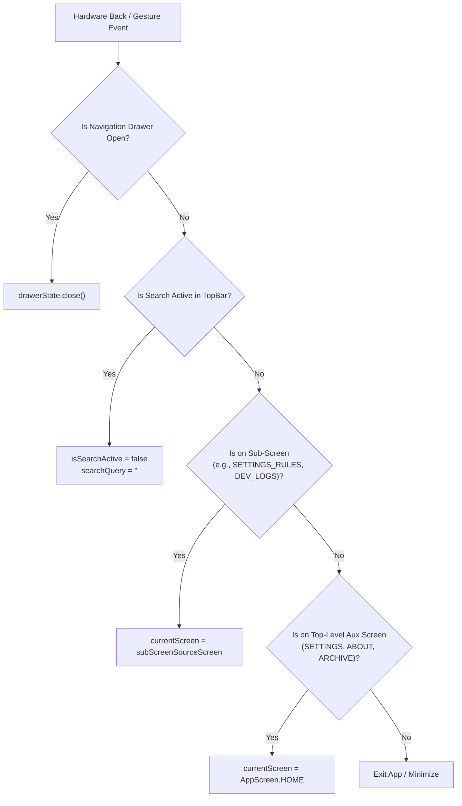

# TextMorph Design System & UI/UX Specification

This document provides the definitive, production-grade design system and UI/UX specification for **TextMorph**, extracted and adapted from the modern Android architecture and Jetpack Compose design patterns of **BookReader TTS**.

---

## Table of Contents
1. [Core Design Principles & Architecture](#1-core-design-principles--architecture)
2. [Color System & Theme Palettes](#2-color-system--theme-palettes)
3. [Typography & Text Hierarchy](#3-typography--text-hierarchy)
4. [Top Navigation Bar & Morphing Search Architecture](#4-top-navigation-bar--morphing-search-architecture)
5. [Dialog Architecture (The Full-Width Responsive Standard)](#5-dialog-architecture-the-full-width-responsive-standard)
6. [Navigation, Routing & BackHandler State Machine](#6-navigation-routing--backhandler-state-machine)
7. [Sidebar / Modal Navigation Drawer](#7-sidebar--modal-navigation-drawer)
8. [General Settings Hub Architecture](#8-general-settings-hub-architecture)
9. [Developer Logs & Global Diagnostic System](#9-developer-logs--global-diagnostic-system)
10. [Component Library & Form Controls](#10-component-library--form-controls)
11. [In-App Update System & Dialog Architecture](#11-in-app-update-system--dialog-architecture)
12. [Design Verification Checklist](#12-design-verification-checklist)

## 1. Core Design Principles & Architecture

### 1.1 Architecture & Stack
- **Framework**: Modern Android Architecture with **Jetpack Compose** and **Material 3 (M3)**.
- **Pattern**: Unidirectional Data Flow (UDF) with MVVM, StateFlow, and Coroutines.
- **Edge-to-Edge**: Full edge-to-edge rendering with `enableEdgeToEdge()` and explicit insets handling (`statusBarsPadding()`, `navigationBarsPadding()`).
- **Responsive Fluidity**: No static, pixel-clipped containers. All dialogs, sheets, cards, and button groups adapt gracefully across all screen widths and font-scale factors.

### 1.2 UX Tenets
1. **Never Clip Actions**: Button actions must never truncate or wrap awkwardly on narrow mobile screens. Use `FlowRow` or vertical stacks for dialog controls.
2. **Context-Aware Navigation**: Navigating deeper into sub-screens preserves the origin route (`subScreenSourceScreen`) so exiting always returns the user to their true previous context.
3. **Layered Back Handling**: Hardware back gestures resolve in a strict hierarchical order:
   `Modal Drawer Open` $\rightarrow$ `Active Search Bar` $\rightarrow$ `Sub-screen` $\rightarrow$ `Top-level Screen` $\rightarrow$ `App Exit`.
4. **Instant In-Place Search**: Any view supporting search embeds a morphing search bar directly in the top app bar rather than shifting screen content down or launching a detached search activity.
5. **Universal Diagnostic Safety**: A global event bus catches unhandled exceptions and presents full-width diagnostic dialogs with copyable stack traces and one-tap log navigation.

---

## 2. Color System & Theme Palettes

TextMorph provides **4 complete themes**, with the **Forest Clay (Earthy Sage)** palette established as the default.

```
┌────────────────────────────────────────────────────────────────────────┐
│                      DEFAULT PALETTE: FOREST CLAY                      │
├────────────────────┬────────────────────┬────────────────────┬─────────┤
│    #2C3930         │    #3F4F44         │    #A27B5C         │ #DCD7C9 │
│    Dark Pine       │    Muted Moss      │    Warm Clay       │ Cream   │
└────────────────────┴────────────────────┴────────────────────┴─────────┘
```

### 2.1 Default Theme: Forest Clay (Earthy Sage)

This palette uses earthy woodland undertones paired with warm terracotta/clay accents and soft oatmeal parchment text.

| Material 3 Role | Hex Code | Color Name | Intended Usage |
| :--- | :--- | :--- | :--- |
| `background` | `#2C3930` | Deep Pine Slate | Root app background, reader backdrop in dark mode |
| `surface` | `#2C3930` | Deep Pine Slate | Top app bars, bottom sheets, base drawer sheet |
| `surfaceVariant` | `#3F4F44` | Muted Moss Green | Card backgrounds, search input fill, list item containers |
| `onSurfaceVariant` | `#B8B2A4` | Muted Oatmeal | Subtitles, helper text, inactive icon tints |
| `primary` | `#A27B5C` | Warm Caramel Clay | Active buttons, switches, slider thumbs, highlight accents |
| `onPrimary` | `#FFFFFF` | Crisp White | Text and icons placed on primary-filled buttons |
| `primaryContainer`| `#483A2E` | Deep Clay Tint | Active list item selection background (alpha-tuned) |
| `onPrimaryContainer`|`#DCD7C9`| Parchment Cream | Text on selected items |
| `secondary` | `#3F4F44` | Muted Moss Green | Secondary chips, badges, segmented controls |
| `onSecondary` | `#DCD7C9` | Parchment Cream | Text on secondary elements |
| `tertiary` | `#C59B76` | Soft Hazelnut | Tertiary highlights, audio badges, progress indicators |
| `onBackground` | `#DCD7C9` | Parchment Cream | Primary headers, body reading text |
| `onSurface` | `#DCD7C9` | Parchment Cream | Dialog titles, drawer labels |
| `outline` | `#3F4F44` | Muted Moss Green | Outlined text fields, card borders, dividers |
| `outlineVariant` | `#3F4F44` (40% $\alpha$) | Subdued Border | Table row dividers, item separators |
| `highlight` | `#44A27B5C` | Clay Highlight Tint | Sentence/word active highlight in audio/reading views |

#### Complementary Light / Parchment Variant (Forest Clay Light)
- `background`: `#DCD7C9` (Soft Oatmeal Parchment)
- `surface`: `#E8E4DA` (Clean Parchment Surface)
- `surfaceVariant`: `#D5CFC0` (Muted Warm Border/Card Fill)
- `primary`: `#A27B5C` (Warm Caramel Clay Accent)
- `onPrimary`: `#FFFFFF`
- `onBackground`: `#2C3930` (Deep Forest Charcoal Body Text)
- `onSurface`: `#2C3930` (Deep Forest Charcoal Headings)
- `outline`: `#B8B09F`

---

### 2.2 Secondary Themes

#### Theme 2: Dark Slate (Midnight OLED)
- `background`: `#0B1020` (`BgDark0` - Deep Midnight Black)
- `surface`: `#111827` (`BgDark1` - Charcoal Surface)
- `surfaceVariant`: `#1F2937` (`BgDark2` - Card Background)
- `primary`: `#2563EB` (`AccentBlue` - Royal Blue)
- `secondary`: `#7C3AED` (`AccentPurple` - Electric Violet)
- `tertiary`: `#DB2777` (`AccentPink` - Vivid Magenta)
- `onBackground` / `onSurface`: `#E5E7EB` (`TextDark` - Crisp Slate White)
- `onSurfaceVariant`: `#9CA3AF` (`MutedDark` - Cool Gray)
- `highlight`: `Color(0x447C3AED)` (Violet Highlight)

#### Theme 3: Warm Sepia (Paper Novel)
- `background`: `#F4ECD8` (`SepiaBg` - Soft Vintage Page)
- `surface`: `#EADBBE` (`SepiaSurface` - Warm Aged Card)
- `surfaceVariant`: `#EADBBE`
- `primary`: `#B45309` (`SepiaAccent` - Amber Leather)
- `secondary`: `#7C3AED`
- `tertiary`: `#2563EB`
- `onBackground` / `onSurface`: `#3B2F1E` (`SepiaText` - Deep Espresso Brown)
- `onSurfaceVariant`: `#78654D` (`SepiaMuted` - Warm Brown Gray)
- `highlight`: `Color(0x38B45309)` (Warm Amber Highlight)

#### Theme 4: Clean Light
- `background`: `#F8FAFC` (`LightBg` - Crisp Off-White)
- `surface`: `#FFFFFF` (`LightSurface` - Pure White)
- `surfaceVariant`: `#F1F5F9` (Light Slate Gray)
- `primary`: `#2563EB` (`AccentBlue` - Deep Royal Blue)
- `onBackground` / `onSurface`: `#0F172A` (`LightText` - Dark Navy Slate)
- `onSurfaceVariant`: `#64748B` (`LightMuted` - Slate Gray)
- `highlight`: `Color(0x382563EB)` (Cool Blue Highlight)

---

### 2.3 Kotlin Theme Implementation (`Theme.kt` & `Color.kt`)

```kotlin
package com.textmorph.theme

import androidx.compose.material3.MaterialTheme
import androidx.compose.material3.darkColorScheme
import androidx.compose.material3.lightColorScheme
import androidx.compose.runtime.Composable
import androidx.compose.ui.graphics.Color

// --- Forest Clay (Default Theme Tokens) ---
val ForestClayBg = Color(0xFF2C3930)
val ForestClaySurfaceVariant = Color(0xFF3F4F44)
val ForestClayPrimary = Color(0xFFA27B5C)
val ForestClayOnText = Color(0xFFDCD7C9)
val ForestClayMuted = Color(0xFFB8B2A4)
val ForestClayHighlight = Color(0x44A27B5C)

// --- Secondary Themes ---
val BgDark0 = Color(0xFF0B1020)
val BgDark1 = Color(0xFF111827)
val BgDark2 = Color(0xFF1F2937)
val AccentBlue = Color(0xFF2563EB)
val AccentPurple = Color(0xFF7C3AED)
val TextDark = Color(0xFFE5E7EB)

val SepiaBg = Color(0xFFF4ECD8)
val SepiaSurface = Color(0xFFEADBBE)
val SepiaText = Color(0xFF3B2F1E)
val SepiaAccent = Color(0xFFB45309)

val LightBg = Color(0xFFF8FAFC)
val LightSurface = Color(0xFFFFFFFF)
val LightText = Color(0xFF0F172A)

// Color Scheme Definitions
private val ForestClayDarkColorScheme = darkColorScheme(
    primary = ForestClayPrimary,
    secondary = ForestClaySurfaceVariant,
    tertiary = Color(0xFFC59B76),
    background = ForestClayBg,
    surface = ForestClayBg,
    surfaceVariant = ForestClaySurfaceVariant,
    onPrimary = Color.White,
    onBackground = ForestClayOnText,
    onSurface = ForestClayOnText,
    onSurfaceVariant = ForestClayMuted,
    outline = ForestClaySurfaceVariant
)

private val DarkSlateColorScheme = darkColorScheme(
    primary = AccentBlue,
    secondary = AccentPurple,
    background = BgDark0,
    surface = BgDark1,
    surfaceVariant = BgDark2,
    onPrimary = TextDark,
    onBackground = TextDark,
    onSurface = TextDark
)

private val SepiaColorScheme = lightColorScheme(
    primary = SepiaAccent,
    background = SepiaBg,
    surface = SepiaSurface,
    surfaceVariant = SepiaSurface,
    onPrimary = SepiaBg,
    onBackground = SepiaText,
    onSurface = SepiaText
)

private val LightColorScheme = lightColorScheme(
    primary = AccentBlue,
    background = LightBg,
    surface = LightSurface,
    surfaceVariant = Color(0xFFF1F5F9),
    onPrimary = LightSurface,
    onBackground = LightText,
    onSurface = LightText
)

enum class ThemeMode {
    FOREST_CLAY, // Default
    DARK_SLATE,
    SEPIA,
    LIGHT
}

@Composable
fun TextMorphTheme(
    themeMode: ThemeMode = ThemeMode.FOREST_CLAY,
    content: @Composable () -> Unit
) {
    val colorScheme = when (themeMode) {
        ThemeMode.FOREST_CLAY -> ForestClayDarkColorScheme
        ThemeMode.DARK_SLATE -> DarkSlateColorScheme
        ThemeMode.SEPIA -> SepiaColorScheme
        ThemeMode.LIGHT -> LightColorScheme
    }

    MaterialTheme(
        colorScheme = colorScheme,
        typography = Typography,
        content = content
    )
}
```

---

## 3. Typography & Text Hierarchy

TextMorph utilizes standard Material 3 typography definitions with dedicated line height, letter spacing, and a strict monospace standard for system identifiers, technical logs, and code.

| Typography Token | Font Weight | Size | Line Height | Tracking | Usage |
| :--- | :--- | :--- | :--- | :--- | :--- |
| `headlineSmall` | Bold (700) | `24.sp` | `32.sp` | `0.sp` | App title, hero cards |
| `titleLarge` | Bold (700) | `20.sp` | `26.sp` | `0.sp` | TopAppBar headers, modal dialog titles |
| `titleMedium` | SemiBold (600) | `16.sp` | `22.sp` | `0.15.sp` | Section headers, card main titles |
| `titleSmall` | SemiBold (600) | `14.sp` | `20.sp` | `0.1.sp` | List item titles, drawer section labels |
| `bodyLarge` | Normal (400) | `16.sp` | `24.sp` | `0.5.sp` | Primary reading view, article content |
| `bodyMedium` | Normal (400) | `14.sp` | `20.sp` | `0.25.sp` | Dialog body descriptions, form labels |
| `bodySmall` | Normal (400) | `12.sp` | `16.sp` | `0.4.sp` | Subtitles, timestamp metadata |
| `labelMedium` | Bold (700) | `12.sp` | `16.sp` | `0.5.sp` | Uppercase section categorization headers |
| `labelSmall` | Medium (500) | `11.sp` | `16.sp` | `0.5.sp` | Chips, badge labels, slider value callouts |
| **Monospace** | Normal (400) | `11.sp` | `15.sp` | `0.sp` | Developer log stack traces, CSS selectors |

---

## 4. Top Navigation Bar & Morphing Search Architecture

### 4.1 Interaction Model
Whenever a route supports search (e.g., Rules, Audio Studio, Log viewer, Filter lists):
1. **Initial (Inactive) State**:
   - Navigation icon: Drawer Menu (`Icons.Default.Menu`) or Back arrow (`Icons.AutoMirrored.Filled.ArrowBack`).
   - Title: Bold screen title (`titleLarge`).
   - Actions: Search icon button (`Icons.Default.Search`) and secondary contextual actions.
2. **Search Mode (Morphing In-Place)**:
   - When the user taps the Search icon, `isSearchActive` becomes `true`.
   - The Back icon switches to `ArrowBack`. Tapping it cancels search (`isSearchActive = false`, `searchQuery = ""`).
   - The title is completely replaced by an expanded `BasicTextField` wrapped in a centered `Row`.
   - The input has single-line restriction, custom cursor color matching `primary`, and an oatmeal/muted placeholder hint (`"Search..."`).
   - As soon as the user types text (`searchQuery.isNotEmpty()`), a trailing Clear icon button (`Icons.Default.Clear`) appears.
   - The right action bar is cleared so the search field occupies the entire top bar width.
3. **Hardware Back Interception**:
   - `BackHandler(enabled = isSearchActive)` intercepts the hardware back button or swipe gesture:
   - Pressing back closes the search bar and clears the query **without navigating away from the current screen**.

```
┌────────────────────────────────────────────────────────────────────────┐
│ INACTIVE TOP BAR                                                       │
│ [<- Back]    Pronunciation Rules                     [Search Q] [+]    │
└────────────────────────────────────────────────────────────────────────┘

┌────────────────────────────────────────────────────────────────────────┐
│ ACTIVE MORPHED SEARCH BAR                                              │
│ [<- Back]  [ Search pronunciation rules...             (X) ]           │
└────────────────────────────────────────────────────────────────────────┘
```

### 4.2 Reusable Compose Specification (`SearchTopAppBar.kt`)

```kotlin
@OptIn(ExperimentalMaterial3Api::class)
@Composable
fun SearchTopAppBar(
    title: String,
    searchQuery: String,
    isSearchActive: Boolean,
    onSearchQueryChange: (String) -> Unit,
    onToggleSearch: (Boolean) -> Unit,
    onNavigateBack: () -> Unit,
    searchPlaceholder: String = "Search...",
    actions: @Composable RowScope.() -> Unit = {}
) {
    // Intercept hardware back button when search is active
    BackHandler(enabled = isSearchActive) {
        onToggleSearch(false)
        onSearchQueryChange("")
    }

    TopAppBar(
        title = {
            if (isSearchActive) {
                Row(
                    verticalAlignment = Alignment.CenterVertically,
                    modifier = Modifier.fillMaxWidth()
                ) {
                    BasicTextField(
                        value = searchQuery,
                        onValueChange = onSearchQueryChange,
                        singleLine = true,
                        textStyle = TextStyle(
                            color = MaterialTheme.colorScheme.onSurface,
                            fontSize = 16.sp
                        ),
                        cursorBrush = SolidColor(MaterialTheme.colorScheme.primary),
                        decorationBox = { innerTextField ->
                            Box(
                                modifier = Modifier.weight(1f),
                                contentAlignment = Alignment.CenterStart
                            ) {
                                if (searchQuery.isEmpty()) {
                                    Text(
                                        text = searchPlaceholder,
                                        style = MaterialTheme.typography.bodyMedium,
                                        color = MaterialTheme.colorScheme.onSurfaceVariant.copy(alpha = 0.6f),
                                        maxLines = 1,
                                        overflow = TextOverflow.Ellipsis
                                    )
                                }
                                innerTextField()
                            }
                        },
                        modifier = Modifier.weight(1f)
                    )
                    if (searchQuery.isNotEmpty()) {
                        IconButton(
                            onClick = { onSearchQueryChange("") },
                            modifier = Modifier.size(36.dp)
                        ) {
                            Icon(
                                Icons.Default.Clear,
                                contentDescription = "Clear search",
                                tint = MaterialTheme.colorScheme.onSurfaceVariant
                            )
                        }
                    }
                }
            } else {
                Text(
                    text = title,
                    style = MaterialTheme.typography.titleLarge.copy(fontWeight = FontWeight.Bold),
                    maxLines = 1,
                    overflow = TextOverflow.Ellipsis
                )
            }
        },
        navigationIcon = {
            IconButton(
                onClick = {
                    if (isSearchActive) {
                        onToggleSearch(false)
                        onSearchQueryChange("")
                    } else {
                        onNavigateBack()
                    }
                }
            ) {
                Icon(
                    Icons.AutoMirrored.Filled.ArrowBack,
                    contentDescription = if (isSearchActive) "Exit Search" else "Back"
                )
            }
        },
        actions = {
            if (!isSearchActive) {
                IconButton(onClick = { onToggleSearch(true) }) {
                    Icon(Icons.Default.Search, contentDescription = "Search")
                }
                actions()
            }
        },
        colors = TopAppBarDefaults.topAppBarColors(
            containerColor = MaterialTheme.colorScheme.surface
        )
    )
}
```

---

## 5. Dialog Architecture (The Full-Width Responsive Standard)

### 5.1 Strict Layout Rules
All dialogs across TextMorph must comply with the following structural rules:

1. **Explicit Full-Width Override**:
   Every `AlertDialog` or `Dialog` must pass:
   ```kotlin
   properties = DialogProperties(usePlatformDefaultWidth = false)
   ```
2. **Consistent Edge Insets**:
   Apply explicit outer margins on the root modifier:
   ```kotlin
   modifier = Modifier
       .fillMaxWidth()
       .padding(horizontal = 16.dp, vertical = 24.dp)
   ```
3. **Card Container**:
   - `shape = RoundedCornerShape(16.dp)`
   - `color = MaterialTheme.colorScheme.surface`
   - `tonalElevation = 6.dp`
   - Content inner padding: `20.dp`
4. **Action Button Wrapping with `FlowRow`**:
   Never place action buttons in a fixed, single-row `Row` where buttons could squash or truncate on narrow displays. All action rows must be wrapped in `FlowRow`:
   ```kotlin
   FlowRow(
       modifier = Modifier.fillMaxWidth(),
       horizontalArrangement = Arrangement.End,
       verticalArrangement = Arrangement.spacedBy(8.dp)
   ) {
       TextButton(onClick = onDismiss) { Text("Cancel") }
       Spacer(modifier = Modifier.width(8.dp))
       Button(onClick = onConfirm, shape = RoundedCornerShape(8.dp)) { Text("Save") }
   }
   ```
5. **Vertical Action Stacks for Destructive Confirmation**:
   For delete/restore decisions, stack buttons vertically with `Column(verticalArrangement = Arrangement.spacedBy(8.dp))` where each button has `Modifier.fillMaxWidth()`.

### 5.2 Form Dialog Reference Pattern (`BaseFormDialog.kt`)

```kotlin
@OptIn(ExperimentalLayoutApi::class, ExperimentalMaterial3Api::class)
@Composable
fun RuleEditorDialog(
    initialFrom: String = "",
    initialTo: String = "",
    initialExactMatch: Boolean = true,
    onDismiss: () -> Unit,
    onSave: (from: String, to: String, exact: Boolean) -> Unit
) {
    var fromText by remember { mutableStateOf(initialFrom) }
    var toText by remember { mutableStateOf(initialTo) }
    var exactMatch by remember { mutableStateOf(initialExactMatch) }

    Dialog(
        onDismissRequest = onDismiss,
        properties = DialogProperties(usePlatformDefaultWidth = false)
    ) {
        Surface(
            shape = RoundedCornerShape(16.dp),
            color = MaterialTheme.colorScheme.surface,
            tonalElevation = 6.dp,
            modifier = Modifier
                .fillMaxWidth()
                .padding(horizontal = 16.dp, vertical = 24.dp)
        ) {
            Column(
                modifier = Modifier
                    .fillMaxWidth()
                    .padding(20.dp)
            ) {
                Text(
                    text = "Edit Morph Rule",
                    style = MaterialTheme.typography.titleLarge.copy(fontWeight = FontWeight.Bold)
                )

                Spacer(modifier = Modifier.height(16.dp))

                // Input Field 1
                OutlinedTextField(
                    value = fromText,
                    onValueChange = { fromText = it },
                    label = { Text("Original text (From)") },
                    placeholder = { Text("e.g. pattern to replace") },
                    singleLine = true,
                    modifier = Modifier.fillMaxWidth(),
                    shape = RoundedCornerShape(10.dp)
                )

                Spacer(modifier = Modifier.height(10.dp))

                // Input Field 2
                OutlinedTextField(
                    value = toText,
                    onValueChange = { toText = it },
                    label = { Text("Replacement text (To)") },
                    placeholder = { Text("e.g. target replacement") },
                    singleLine = true,
                    modifier = Modifier.fillMaxWidth(),
                    shape = RoundedCornerShape(10.dp)
                )

                Spacer(modifier = Modifier.height(14.dp))

                // Toggle Row
                Row(
                    modifier = Modifier.fillMaxWidth(),
                    horizontalArrangement = Arrangement.SpaceBetween,
                    verticalAlignment = Alignment.CenterVertically
                ) {
                    Column(modifier = Modifier.weight(1f)) {
                        Text(
                            "Exact word boundary",
                            style = MaterialTheme.typography.bodyMedium.copy(fontWeight = FontWeight.SemiBold)
                        )
                        Text(
                            if (exactMatch) "Only matches whole words" else "Matches any substring",
                            style = MaterialTheme.typography.bodySmall,
                            color = MaterialTheme.colorScheme.onSurfaceVariant
                        )
                    }
                    Switch(
                        checked = exactMatch,
                        onCheckedChange = { exactMatch = it }
                    )
                }

                Spacer(modifier = Modifier.height(20.dp))

                // Responsive FlowRow Actions
                FlowRow(
                    modifier = Modifier.fillMaxWidth(),
                    horizontalArrangement = Arrangement.End,
                    verticalArrangement = Arrangement.spacedBy(8.dp)
                ) {
                    TextButton(onClick = onDismiss) {
                        Text("Cancel")
                    }
                    Spacer(modifier = Modifier.width(8.dp))
                    Button(
                        onClick = {
                            if (fromText.isNotBlank() && toText.isNotBlank()) {
                                onSave(fromText.trim(), toText.trim(), exactMatch)
                            }
                        },
                        enabled = fromText.isNotBlank() && toText.isNotBlank(),
                        shape = RoundedCornerShape(8.dp)
                    ) {
                        Text("Save Rule")
                    }
                }
            }
        }
    }
}
```

---

## 6. Navigation, Routing & BackHandler State Machine

### 6.1 Screen Enumeration & Source Tracking
TextMorph structures all primary and secondary routes into an `AppScreen` enum. Sub-screens track their caller through a `subScreenSourceScreen` state variable.

```kotlin
enum class AppScreen {
    HOME,
    STUDIO,
    BROWSER,
    SETTINGS,
    ABOUT,
    DEV_LOGS,
    CHANGELOG,
    SETTINGS_RULES,
    SETTINGS_FILTERS,
    SETTINGS_SELECTORS,
    SETTINGS_HARDWARE
}
```

```kotlin
var currentScreen by rememberSaveable { mutableStateOf(AppScreen.HOME) }
var subScreenSourceScreen by rememberSaveable { mutableStateOf(AppScreen.SETTINGS) }

val navigateToSubScreen: (AppScreen) -> Unit = { target ->
    if (currentScreen in listOf(AppScreen.HOME, AppScreen.STUDIO, AppScreen.BROWSER, AppScreen.SETTINGS)) {
        subScreenSourceScreen = currentScreen
    }
    currentScreen = target
}
```

### 6.2 BackHandler Precedence Hierarchy
To guarantee smooth UX without unexpected exits, `BackHandler`s are prioritized as follows:



```kotlin
// 1. Drawer BackHandler
BackHandler(enabled = drawerState.isOpen) {
    scope.launch { drawerState.close() }
}

// 2. Sub-Screen BackHandler
BackHandler(enabled = !drawerState.isOpen && currentScreen == AppScreen.SETTINGS_RULES) {
    currentScreen = subScreenSourceScreen
}

BackHandler(enabled = !drawerState.isOpen && currentScreen == AppScreen.DEV_LOGS) {
    currentScreen = AppScreen.ABOUT
}

// 3. Top-Level Auxiliary BackHandler
BackHandler(enabled = !drawerState.isOpen && (currentScreen == AppScreen.SETTINGS || currentScreen == AppScreen.ABOUT)) {
    currentScreen = AppScreen.HOME
}
```

---

## 7. Sidebar / Modal Navigation Drawer

### 7.1 Drawer Layout Architecture
The drawer is hosted inside `ModalNavigationDrawer` using `ModalDrawerSheet` with a fixed standard width of `320.dp`.

```
┌──────────────────────────────────────┐
│  TextMorph Library                   │
│  [Studio] [Folder] [Refresh] [Close] │
├──────────────────────────────────────┤
│  [ Files (12) ]    [ Items (84) ]    │
├──────────────────────────────────────┤
│                                      │
│  LazyColumn of Library Items         │
│  - Active highlight background       │
│  - Long-press reveals inline actions │
│    [Drag 6-dots] [Share] [Del]       │
│                                      │
├──────────────────────────────────────┤
│  [Settings Gear] Settings            │
│  General, Appearance, CSS & Prefs    │
├──────────────────────────────────────┤
│  [Info Icon] About TextMorph         │
│  v1.0.0       [Bug Icon: Dev Logs] ->│
└──────────────────────────────────────┘
```

### 7.2 Drawer Footer Specification
The footer stays firmly pinned to the bottom of the drawer sheet, containing two high-visibility action rows:

1. **General Settings**:
   - `Surface(onClick = onOpenSettings, modifier = Modifier.fillMaxWidth())`
   - Icon: `Icons.Default.Settings` in `primary` tint (`#A27B5C`).
   - Title: "Settings" (`titleSmall`, SemiBold).
   - Subtitle: "Appearance, Rules & Preferences" (`bodySmall`, 11sp).
2. **About Page with Quick Debug Launcher**:
   - `Surface(onClick = onOpenAbout, modifier = Modifier.fillMaxWidth())`
   - Icon: `Icons.Default.Info` in `primary` tint.
   - Title: "About TextMorph" (`titleSmall`, SemiBold).
   - Subtitle: "v1.0.0" (`bodySmall`).
   - **Direct Developer Logs Bug Icon**: An inline `IconButton` containing `Icons.Default.BugReport` sits directly inside this row, enabling one-tap access to live diagnostic logs without entering the About screen first.
   - Trailing: `Icons.AutoMirrored.Filled.ArrowForward` chevron.

---

## 8. General Settings Hub Architecture

### 8.1 Categorized Section Cards
Settings are organized into clear thematic groupings with capitalized `labelMedium` headers and rounded container cards:

```kotlin
@Composable
fun SettingsCategoryHeader(title: String) {
    Text(
        text = title,
        style = MaterialTheme.typography.labelMedium.copy(
            fontWeight = FontWeight.Bold,
            color = MaterialTheme.colorScheme.primary
        ),
        modifier = Modifier.padding(vertical = 8.dp)
    )
}
```

Each group is enclosed in:
```kotlin
Card(
    shape = RoundedCornerShape(16.dp),
    colors = CardDefaults.cardColors(
        containerColor = MaterialTheme.colorScheme.surfaceVariant.copy(alpha = 0.5f)
    ),
    modifier = Modifier.fillMaxWidth()
) {
    Column { /* Navigation Items */ }
}
```

### 8.2 Standard Settings Rows (`SettingsNavigationItem`)
```kotlin
@Composable
fun SettingsNavigationItem(
    icon: ImageVector,
    title: String,
    subtitle: String,
    onClick: () -> Unit,
    tint: Color = MaterialTheme.colorScheme.primary
) {
    Surface(
        onClick = onClick,
        color = Color.Transparent,
        modifier = Modifier.fillMaxWidth()
    ) {
        Row(
            modifier = Modifier
                .fillMaxWidth()
                .padding(horizontal = 16.dp, vertical = 14.dp),
            verticalAlignment = Alignment.CenterVertically
        ) {
            Icon(
                imageVector = icon,
                contentDescription = null,
                tint = tint,
                modifier = Modifier.size(24.dp)
            )
            Spacer(modifier = Modifier.width(16.dp))
            Column(modifier = Modifier.weight(1f)) {
                Text(
                    text = title,
                    style = MaterialTheme.typography.bodyMedium.copy(fontWeight = FontWeight.SemiBold),
                    color = MaterialTheme.colorScheme.onSurface
                )
                Spacer(modifier = Modifier.height(2.dp))
                Text(
                    text = subtitle,
                    style = MaterialTheme.typography.bodySmall,
                    color = MaterialTheme.colorScheme.onSurfaceVariant
                )
            }
            Icon(
                imageVector = Icons.AutoMirrored.Filled.ArrowForward,
                contentDescription = null,
                tint = MaterialTheme.colorScheme.onSurfaceVariant.copy(alpha = 0.5f),
                modifier = Modifier.size(18.dp)
            )
        }
    }
}
```

### 8.3 Theme Selection Chips Row
The theme switcher uses a horizontal row of `ThemeOptionChip` elements inside the Appearance card:
```kotlin
Row(
    modifier = Modifier.fillMaxWidth(),
    horizontalArrangement = Arrangement.spacedBy(8.dp)
) {
    ThemeOptionChip(
        label = "Forest",
        icon = "🌲",
        isSelected = currentTheme == ThemeMode.FOREST_CLAY,
        onClick = { onThemeChange(ThemeMode.FOREST_CLAY) },
        modifier = Modifier.weight(1f)
    )
    ThemeOptionChip(
        label = "Dark",
        icon = "🌙",
        isSelected = currentTheme == ThemeMode.DARK_SLATE,
        onClick = { onThemeChange(ThemeMode.DARK_SLATE) },
        modifier = Modifier.weight(1f)
    )
    ThemeOptionChip(
        label = "Sepia",
        icon = "📜",
        isSelected = currentTheme == ThemeMode.SEPIA,
        onClick = { onThemeChange(ThemeMode.SEPIA) },
        modifier = Modifier.weight(1f)
    )
}
```

---

## 9. Developer Logs & Global Diagnostic System

TextMorph incorporates a dual-layer diagnostic architecture: a **Global Error Bus** for unhandled crashes, and a dedicated **Developer Logs Screen**.

```
┌────────────────────────────────────────────────────────────────────────┐
│ UNHANDLED EXCEPTION INTERCEPTOR DIALOG                                 │
│ (!) Synthesis Pipeline Error                                           │
│ Failed to transform chapter block at index 14                          │
│ ┌────────────────────────────────────────────────────────────────────┐ │
│ │ java.lang.IllegalStateException: Corrupt buffer                     │ │
│ │   at com.textmorph.engine.Parser.run(Parser.kt:42)                 │ │
│ └────────────────────────────────────────────────────────────────────┘ │
│ [ Copy Error Log ]                                                     │
│ [ Open Dev Logs ]                             [ Dismiss ]              │
└────────────────────────────────────────────────────────────────────────┘
```

### 9.1 Global Error Interceptor (`AppErrorBus`)
Any component encountering an unrecoverable error publishes to `AppErrorBus.postError(title, message, exception)`.
A root-level `AlertDialog` immediately captures this:
- **Icon**: `Icons.Default.Warning` with `error` tint.
- **Scrollable Monospace Trace**: Stack trace rendered inside `Surface(color = surfaceVariant)` using `FontFamily.Monospace` and `fontSize = 11.sp` inside a `SelectionContainer` so the user can easily select and copy text.
- **Actions**:
  1. `Button`: "Copy Error Log" (writes formatted log string directly to `ClipboardManager`).
  2. `OutlinedButton`: "Open Dev Logs" (dismisses dialog and routes immediately to `AppScreen.DEV_LOGS`).
  3. `TextButton`: "Dismiss".

### 9.2 Developer Logs Screen (`DevLogsScreen`)
1. **Header Toolbar**:
   - Status: "Last 60m • 24/85 entries".
   - Actions:
     - Dump Logcat (`Icons.Default.Refresh`) - pulls system logcat into memory buffer.
     - Copy All (`Icons.Default.ContentCopy`) - copies formatted telemetry to clipboard.
     - Share Logs (`Icons.Default.Share`) - opens Android system share sheet (`ACTION_SEND`).
     - Clear (`Icons.Default.DeleteSweep`) - wipes current memory log buffer.
2. **Search & Filter Bar**:
   - Text field filtering dynamically by tag, message, or stack trace.
   - Filter chips row: `All`, `Errors`, `Warnings`, `Info`, `Debug` with real-time entry counters.
3. **Log Entry Cards**:
   - Color-coded severity badge (Red for `ERROR`, Amber for `WARN`, Blue/Teal for `INFO`, Gray for `DEBUG`).
   - Monospace formatted log timestamp, tag, and message.
   - Expandable card disclosing full stack traces.

---

## 10. Component Library & Form Controls

### 10.1 Buttons
- **Primary Action**: Filled button with `RoundedCornerShape(8.dp)` or `10.dp`, background in `primary` (`#A27B5C`), text in white.
- **Secondary Action**: `OutlinedButton` with 1dp border in `primary` or `outline`.
- **Dismiss / Neutral**: `TextButton` with `onSurfaceVariant` text.
- **Icon Buttons**: Minimum touch target of `48.dp` with centered `24.dp` icon.

### 10.2 Text Inputs
- **Outlined Form Input**:
  - `OutlinedTextField`
  - Shape: `RoundedCornerShape(10.dp)`
  - Colors: Unfocused container uses `surfaceVariant.copy(alpha = 0.3f)`; focused uses `surfaceVariant.copy(alpha = 0.5f)`.
- **TopBar Search Input**:
  - `BasicTextField` with custom `SolidColor(primary)` cursor brush and floating placeholder.

### 10.3 Sliders & Preset Pills
Sliders pair the continuous slider with a row of quick-select preset pills underneath:
```kotlin
Slider(
    value = speedRate,
    onValueChange = { speedRate = it },
    valueRange = 0.5f..2.5f,
    steps = 39
)

FlowRow(
    modifier = Modifier.fillMaxWidth(),
    horizontalArrangement = Arrangement.spacedBy(8.dp),
    verticalArrangement = Arrangement.spacedBy(6.dp)
) {
    listOf(0.5f, 0.75f, 1.0f, 1.25f, 1.5f, 2.0f).forEach { rate ->
        val isSelected = kotlin.math.abs(speedRate - rate) < 0.03f
        Surface(
            shape = RoundedCornerShape(8.dp),
            color = if (isSelected) MaterialTheme.colorScheme.primary else MaterialTheme.colorScheme.surfaceVariant,
            modifier = Modifier.clickable { speedRate = rate }
        ) {
            Text(
                text = "${rate}x",
                fontSize = 11.sp,
                fontWeight = if (isSelected) FontWeight.Bold else FontWeight.Normal,
                color = if (isSelected) Color.White else MaterialTheme.colorScheme.onSurface,
                modifier = Modifier.padding(horizontal = 10.dp, vertical = 6.dp)
            )
        }
    }
}
```

### 10.4 Toggles & Switches
Material 3 `Switch` components paired with a two-line label:
- Bold primary label (`bodyMedium`, SemiBold).
- Subdued descriptive explanation (`bodySmall`, `onSurfaceVariant`).

---

## 11. In-App Update System & Dialog Architecture

TextMorph implements an integrated, non-intrusive update delivery pipeline modeled after the BookReader TTS update engine (`AppUpdateManager.kt`). It supports silent background checks, manual update triggers on the About screen, and root-level dialog overlays that can present across any active screen route without interrupting user workflows.

```
┌────────────────────────────────────────────────────────────────────────┐
│ ROOT SYSTEM UPDATE OVERLAY (Across All Routes)                         │
│ [↑ SystemUpdate]                                                      │
│ Update Available                                                       │
│ v1.2.0 • 24.5 MB                                                       │
│ ┌────────────────────────────────────────────────────────────────────┐ │
│ │ Release Notes:                                                     │ │
│ │ • Added On-Device LiteRT-LM GPU inference engine                   │ │
│ │ • Added Direct Downloads zero-copy model loader                    │ │
│ │ • Added Floating AI Accessibility toolbar                          │ │
│ └────────────────────────────────────────────────────────────────────┘ │
│ [ Download & Install ]                                                 │
│ [ Save APK to Downloads... ]                                           │
│ [ Later ]                                                              │
└────────────────────────────────────────────────────────────────────────┘
```

### 11.1 Update Checking Lifecycle & Triggers
1. **Silent Background Check on Startup**:
   - Triggered on launch via `LaunchedEffect(Unit)` in `MainActivity`.
   - Silent mode: No UI toasts or interruptions if no update exists. Only displays `UpdateAvailableDialog` if a newer version is detected.
2. **Manual Check on About Screen**:
   - The About screen features an explicit "Check for Updates" button with a spinning `AppLoadingIndicator`.
   - Surfaces instant user feedback (Toast if already up-to-date, or launches `UpdateAvailableDialog` if an update is found).
3. **Root Window Mounting**:
   - Update dialogs are declared directly in `MainActivity.kt` at the root `Surface` level (outside the `when (currentScreen)` block).
   - This ensures the dialog appears on top of whatever screen the user is currently interacting with without disrupting navigation state.

---

### 11.2 Dialog 1: Update Available (`UpdateAvailableDialog.kt`)
Conforms to the full-width responsive standard with a vertical action stack:

- **Dialog Properties**: `DialogProperties(usePlatformDefaultWidth = false)`
- **Modifier**: `Modifier.fillMaxWidth().padding(horizontal = 16.dp, vertical = 24.dp)`
- **Icon**: `Icons.Default.SystemUpdate` in `primary` tint (`#A27B5C`), size `36.dp`.
- **Title**:
  - Main title: `"Update Available"` (`titleLarge`, Bold).
  - Version & size subtitle: `"${updateInfo.tagName} • ${updateInfo.formattedSize}"` (`bodyMedium`, `primary` color, SemiBold).
- **Release Notes Box**:
  - `Surface(shape = RoundedCornerShape(8.dp), color = surfaceVariant.copy(alpha = 0.5f), modifier = Modifier.fillMaxWidth().heightIn(max = 240.dp))`
  - Encloses a `LazyColumn` displaying the Markdown release body in `bodySmall` with `lineHeight = 18.sp`.
- **Vertical Button Stack (`confirmButton`)**:
  - Button 1 (Filled Primary, `shape = RoundedCornerShape(10.dp)`):
    - If APK already downloaded: `Icons.Default.InstallMobile` + `"Install Now"`
    - If APK not yet downloaded: `Icons.Default.Download` + `"Download & Install"`
  - Button 2 (Outlined, `shape = RoundedCornerShape(10.dp)`):
    - `Icons.Default.Download` + `"Save APK to Downloads..."` (triggers Android SAF CreateDocument contract).
  - Button 3 (TextButton):
    - `"Later"` (dismisses the dialog).

```kotlin
@Composable
fun UpdateAvailableDialog(
    updateInfo: UpdateInfo,
    downloadedApk: File?,
    onDownloadClick: () -> Unit,
    onInstallClick: () -> Unit,
    onSaveToPathClick: () -> Unit = {},
    onDismiss: () -> Unit
) {
    AlertDialog(
        onDismissRequest = onDismiss,
        properties = DialogProperties(usePlatformDefaultWidth = false),
        modifier = Modifier
            .fillMaxWidth()
            .padding(horizontal = 16.dp, vertical = 24.dp),
        icon = {
            Icon(
                imageVector = Icons.Default.SystemUpdate,
                contentDescription = null,
                tint = MaterialTheme.colorScheme.primary,
                modifier = Modifier.size(36.dp)
            )
        },
        title = {
            Column(horizontalAlignment = Alignment.CenterHorizontally) {
                Text(
                    text = "Update Available",
                    style = MaterialTheme.typography.titleLarge.copy(fontWeight = FontWeight.Bold),
                    textAlign = TextAlign.Center
                )
                Spacer(modifier = Modifier.height(4.dp))
                val sizeStr = if (updateInfo.formattedSize.isNotEmpty()) " • ${updateInfo.formattedSize}" else ""
                Text(
                    text = "${updateInfo.tagName}$sizeStr",
                    style = MaterialTheme.typography.bodyMedium.copy(
                        color = MaterialTheme.colorScheme.primary,
                        fontWeight = FontWeight.SemiBold
                    ),
                    textAlign = TextAlign.Center
                )
            }
        },
        text = {
            Column(
                modifier = Modifier
                    .fillMaxWidth()
                    .padding(vertical = 4.dp)
            ) {
                Text(
                    text = "Release Notes:",
                    style = MaterialTheme.typography.titleSmall.copy(fontWeight = FontWeight.Bold)
                )
                Spacer(modifier = Modifier.height(6.dp))
                Surface(
                    shape = RoundedCornerShape(8.dp),
                    color = MaterialTheme.colorScheme.surfaceVariant.copy(alpha = 0.5f),
                    modifier = Modifier
                        .fillMaxWidth()
                        .heightIn(max = 240.dp)
                ) {
                    LazyColumn(
                        modifier = Modifier
                            .fillMaxWidth()
                            .padding(12.dp)
                    ) {
                        item {
                            Text(
                                text = updateInfo.body,
                                style = MaterialTheme.typography.bodySmall,
                                lineHeight = 18.sp,
                                color = MaterialTheme.colorScheme.onSurfaceVariant
                            )
                        }
                    }
                }
            }
        },
        confirmButton = {
            Column(
                modifier = Modifier.fillMaxWidth(),
                verticalArrangement = Arrangement.spacedBy(8.dp)
            ) {
                Button(
                    modifier = Modifier.fillMaxWidth(),
                    onClick = {
                        if (downloadedApk != null && downloadedApk.exists()) {
                            onInstallClick()
                        } else {
                            onDownloadClick()
                        }
                    },
                    shape = RoundedCornerShape(10.dp)
                ) {
                    if (downloadedApk != null && downloadedApk.exists()) {
                        Icon(Icons.Default.InstallMobile, contentDescription = null, modifier = Modifier.size(18.dp))
                        Spacer(modifier = Modifier.width(6.dp))
                        Text("Install Now")
                    } else {
                        Icon(Icons.Default.Download, contentDescription = null, modifier = Modifier.size(18.dp))
                        Spacer(modifier = Modifier.width(6.dp))
                        Text("Download & Install")
                    }
                }
                OutlinedButton(
                    modifier = Modifier.fillMaxWidth(),
                    onClick = onSaveToPathClick,
                    shape = RoundedCornerShape(10.dp)
                ) {
                    Icon(Icons.Default.Download, contentDescription = null, modifier = Modifier.size(16.dp))
                    Spacer(modifier = Modifier.width(6.dp))
                    Text("Save APK to Downloads...")
                }
                TextButton(
                    modifier = Modifier.fillMaxWidth(),
                    onClick = onDismiss
                ) {
                    Text("Later")
                }
            }
        },
        dismissButton = null
    )
}
```

---

### 11.3 Dialog 2: Update Downloading (`UpdateDownloadingDialog.kt`)
Displays real-time download telemetry with a non-dismissible scrim to prevent incomplete writes:

- **Properties**: `DialogProperties(dismissOnBackPress = false, dismissOnClickOutside = false)`
- **Icon**: `Icons.Default.Download` in `primary` tint, size `36.dp`.
- **Title**: `"Downloading Update"` (`titleMedium`, Bold).
- **Progress Indicator**:
  - `LinearProgressIndicator` clipped with `RoundedCornerShape(4.dp)`, height `8.dp`.
  - Determinate when `progress > 0f`; switches to indeterminate animation if server length is unknown.
- **Readout Text**:
  - Formatted byte counter: `"%.1f MB / %.1f MB (%d%%)".format(dlMb, totMb, percent)` in `bodySmall`.
- **Dismiss Button**:
  - `TextButton` labeled `"Cancel"` to safely abort the active download coroutine.

```kotlin
@Composable
fun UpdateDownloadingDialog(
    progress: Float,
    downloadedBytes: Long,
    totalBytes: Long,
    onCancel: () -> Unit
) {
    AlertDialog(
        onDismissRequest = {},
        properties = DialogProperties(dismissOnBackPress = false, dismissOnClickOutside = false),
        modifier = Modifier
            .fillMaxWidth()
            .padding(horizontal = 20.dp),
        icon = {
            Icon(
                imageVector = Icons.Default.Download,
                contentDescription = null,
                tint = MaterialTheme.colorScheme.primary,
                modifier = Modifier.size(36.dp)
            )
        },
        title = {
            Text(
                text = "Downloading Update",
                style = MaterialTheme.typography.titleMedium.copy(fontWeight = FontWeight.Bold),
                textAlign = TextAlign.Center
            )
        },
        text = {
            Column(
                modifier = Modifier.fillMaxWidth(),
                horizontalAlignment = Alignment.CenterHorizontally
            ) {
                Spacer(modifier = Modifier.height(8.dp))
                LinearProgressIndicator(
                    progress = { if (progress > 0f) progress else 0f },
                    modifier = Modifier
                        .fillMaxWidth()
                        .height(8.dp)
                        .clip(RoundedCornerShape(4.dp))
                )
                Spacer(modifier = Modifier.height(12.dp))
                val dlMb = downloadedBytes.toDouble() / (1024.0 * 1024.0)
                val totMb = totalBytes.toDouble() / (1024.0 * 1024.0)
                val percent = (progress * 100).toInt()
                val progressText = if (totalBytes > 0) {
                    "%.1f MB / %.1f MB (%d%%)".format(dlMb, totMb, percent)
                } else {
                    "%.1f MB downloaded...".format(dlMb)
                }
                Text(
                    text = progressText,
                    style = MaterialTheme.typography.bodySmall,
                    color = MaterialTheme.colorScheme.onSurfaceVariant
                )
            }
        },
        confirmButton = {},
        dismissButton = {
            TextButton(onClick = onCancel) {
                Text("Cancel")
            }
        }
    )
}
```

---

### 11.4 Dialog 3: Signature Mismatch Guard (`SignatureMismatchDialog.kt`)
When a downloaded update was signed with a different key (e.g., switching between debug build and GitHub release keystore):
- Prevents silent installation failure or corrupt package state.
- **Icon**: `Icons.Default.Warning` with `error` tint.
- **Title**: `"Signature Mismatch Detected"`
- **Options**:
  1. `"Save APK to Downloads..."` (allows manual installation or backup).
  2. `"Force Install / Overwrite"` (triggers package installer with force flag).
  3. `"Dismiss"`

---

## 12. Design Verification Checklist

When building or updating screens in TextMorph, verify compliance against this checklist:

- [ ] **Default Palette**: Screen adheres to Forest Clay (`#2C3930` background, `#3F4F44` cards/borders, `#A27B5C` accents, `#DCD7C9` text).
- [ ] **Full-Width Dialogs**: Dialog uses `DialogProperties(usePlatformDefaultWidth = false)` and `Modifier.fillMaxWidth().padding(horizontal = 16.dp, vertical = 24.dp)`.
- [ ] **No Squashed Buttons**: Dialog actions are wrapped in `FlowRow` with `Arrangement.End` or full-width vertical stacks.
- [ ] **Morphing TopBar Search**: Searchable routes transition the TopAppBar title into a `BasicTextField` with a clear button and `BackHandler` interception.
- [ ] **Sidebar Structure**: Drawer includes tabbed categories, long-press action modes, and a pinned footer with Settings, About, and the Dev Logs shortcut.
- [ ] **Sub-Screen Routing**: Sub-screens capture `subScreenSourceScreen` to pop back to the true origin view.
- [ ] **Global Error Catching**: Errors route through `AppErrorBus` to display a full-width diagnostic dialog with copyable stack traces.
- [ ] **In-App Update System**: Root-level mounting of `UpdateAvailableDialog`, `UpdateDownloadingDialog`, and `SignatureMismatchDialog` with formatted byte progress and Release Notes scrollbox.

